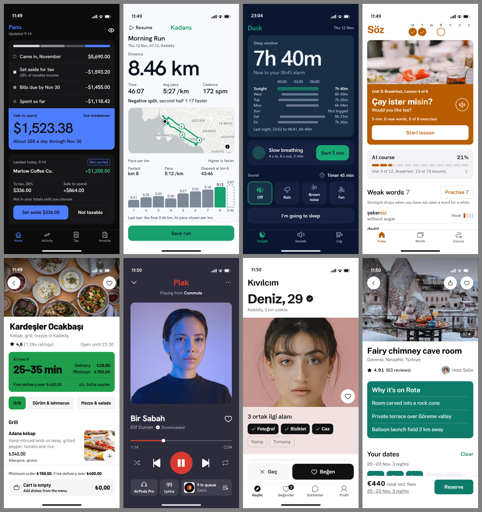
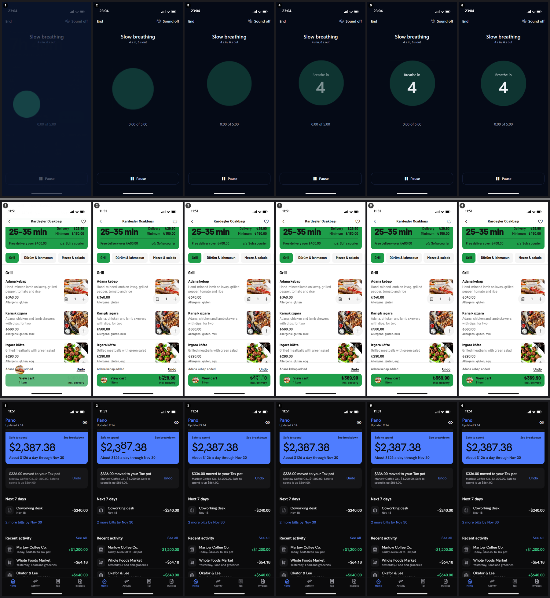
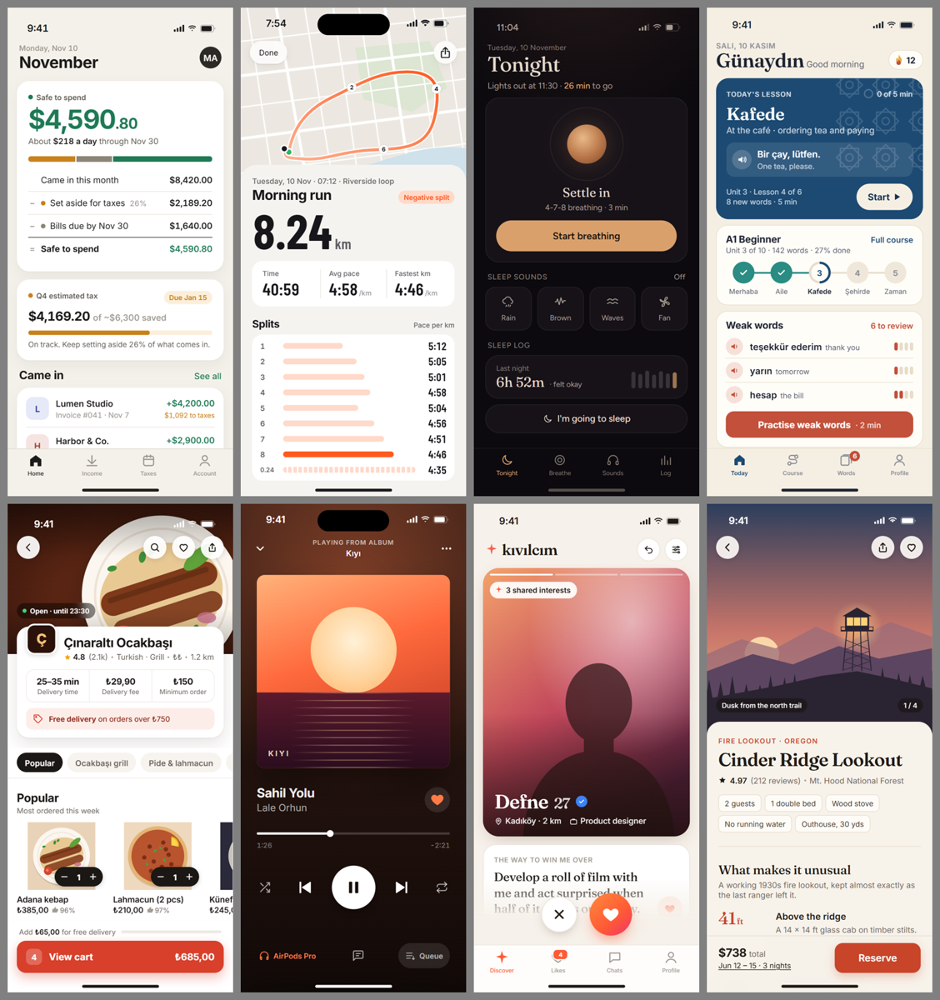
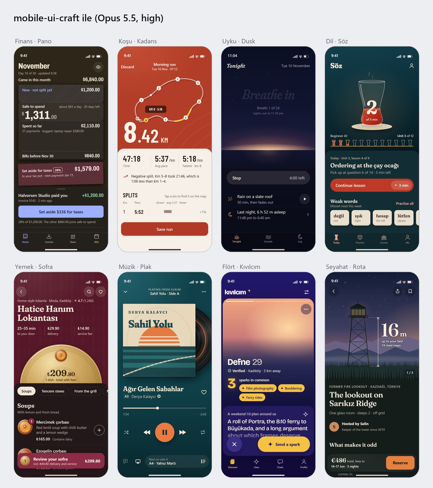
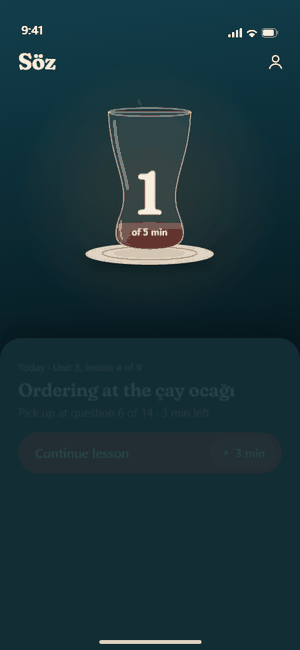
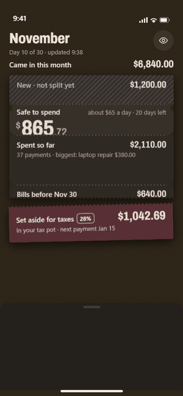
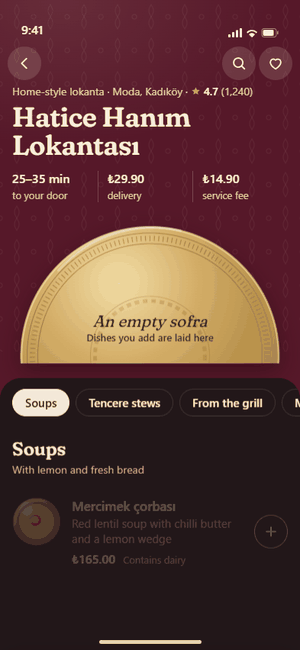
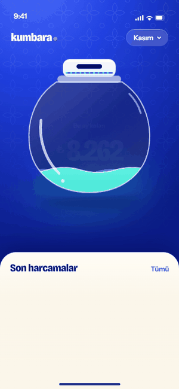

# skill4everything

Kişisel kullanım için AI ajan skill'leri. Açık standart olan `SKILL.md` biçiminde yazıldıkları için Claude Code, Codex, Cursor, Gemini CLI, GitHub Copilot, OpenCode, Amp, Zed ve bu biçimi okuyan diğer ajanlarda çalışır.

| Skill | Ne yapar |
|---|---|
| [`mobile-ui-craft`](skills/mobile-ui-craft/SKILL.md) | Mobil uygulama arayüzünü tasarlar, yazar, yeniden stillendirir ve inceler: her uygulamaya kendine ait, AI yapımı gibi görünmeyen bir görünüm verir |

## mobile-ui-craft

iOS (SwiftUI, UIKit), Android (Jetpack Compose), Flutter ve React Native / Expo için.

AI yapımı arayüzü ele veren üç şey var: seçilmemiş varsayılanlar, modelin kendi zevki (aynı birkaç font, vektörle çizilmiş resim ve ikonlar, renkli bir alan üstüne yükselen yuvarlak kart, parıltılar, orta noktayla dizilmiş künyeler) ve zevke karşı verilen ilacın kendisi: rastgele seçim. 3.x sürümü yazı tipini, rengi, iskeleti ve efekti ayrı ayrı zar atarak dağıtıyordu. Sonuç tutarsızdı (siyah üstünde mor ve serif bir koşu özeti, bordo bir müzik çalar), kullanıcı beğenmedi ve kör testte ekranların yaklaşık yüzde 80'i yine AI sanıldı. Gri boş kutular (fotoğraf, kapak ve haritanın olması gereken yerde) ekranları bitmemiş gösteriyordu, ve her prototip tek bir durağan ekrandı.

Kutlanan uygulamalar tersini yapıyor: konudan başlıyor ve tek bir tutarlı sistem türetiyor. Beyaz ya da koyu zemin, ölçülü tek vurgu, tek yazı ailesi (çoğu zaman sistem fontu), bir imge kuralı ve tek bir imza etkileşimi. Skill 5 bunu işe çeviriyor:

1. **Yön dağıtılır, zar atılmaz.** `scripts/deal.mjs` ürün adı ve nişle, on araştırılmış yönden (yerli sessiz yardımcı, veri kahraman, ağırbaşlı koyu, fotoğraflı editoryal, tek gürültülü marka rengi, yuvarlak alışkanlık, okuma odası, sessiz duyusal, profesyonel araç, sosyal afiş) nişe uyan iki ya da üçünden birini seçer. Yön tek bir yazı tipi ailesi (okuma odasında metin yüzü artı sistem fontu), açık ve koyu için renk değerleri (kontrast kodda denetlenmiş), ikon seti, imge kuralı, imza anı ve "kötü sürüm" uyarısı getirir. Yerleşim dağıtılmaz: nişin lider uygulamalarının düzeni korunur. Yön bağlayıcıdır, gerekçesi yazılmak şartıyla bir kez yeniden dağıtılabilir.
2. **Gerçek malzeme, gri kutu değil.** Çizilmiş resim ve ikon yok, boş yuva yok: `assets/imagery.md` içinde tek tek doğrulanmış 162 Unsplash fotoğrafı, kamu malı sanat eserleri, anahtarsız gerçek harita (MapLibre ile OpenFreeMap) ve içerikten örneklenen renk. Her görsel yuvasında "asla gri" deseni: fotoğrafa yakın bir renk, yumuşak giriş, hatada gizleme.
3. **Prototip kullanılır, bakılmaz.** Ana görevin sonraki adımı kurulur (sepet sayfası, inceleme ve ödeme, nefes seansı, sıradaki profil), diğer sekmeler gerçek birer görünüm açar, ölü kontrol yok. Durumlar URL hash'iyle açılır (`#loading`, `#empty`, `#error`, `#offline`). Geri bildirim içeriğin üstüne binen bir bildirimde değil, sabit çubukta ya da eylemin olduğu satırda durur; geri alma gerçekten geri alır, Esc ve geri tuşu kaydedileni silmez, sayfa kaydırma konumu korunur, hiçbir şey kendiliğinden olmaz. Ajan bitirmeden önce prototipi `capture.mjs --steps` ile kendisi sürer, kareleri ve geçiş filmini inceler ve yedi maddelik "9 çıtası"na göre puanlar (`references/ux-check.md`).
4. **İmza hareketi: aynı nesne yolculuk eder.** Nişe göre dağıtılan tek bir hareket, gerçek içerik üzerinde: "+" düğmesi adet seçiciye dönüşür ve yemek fotoğrafı sepete uçar, kartın üstündeki küçük halka tam ekran nefes şekline büyür, sıradaki kapak ana kapağa büyür, yalnızca değişen rakamlar yuvarlanır. Yaylar Apple ve Material 3 Expressive'in yayımlanmış değerleriyle, her an kesilebilir, Azaltılmış Hareket sürümüyle. 3D yalnızca elde tutulabilecek nesneler için (kart çevirme, kapak akışı, derinlik yığını); sarmal ve kapak akışı yalnızca vitrin. `assets/motion-kit.js` bunları test edilmiş, bağımlılıksız küçük bir kitle veriyor. Her ekranda ürün adı ve ekranın yaklaşık beşte birini kaplayan tek bir marka yüzeyi var.
5. **Tipografi ve sembol izleri engellenir.** İtalik başlık, başlık üstünde küçük harf aralıklı etiket, başlık ya da kart kenarında dikey çizgi, etiket önünde süs noktası, ikon yerine Unicode sembol (→ ✓ ★ ✦ ▲), düğme sonunda ok, 01/02 numaralı etiketler, her başlığa süs ikonu ve modelin hazır metafor ikonları (yıldız parıltısı, roket, şimşek, alev, yaprak). `slop-scan.mjs` bunları "engelleyici" grupta yakalar ve rapor verilmeden temizlenmeleri gerekir; yıldızlı puan ve seçili durumdaki tik gibi gerçek uygulama gelenekleri serbest.
6. **Metin anlatmaz, etiketler.** Ekran başına en fazla bir açıklama cümlesi, kısa etiketler, sıradan örnek veri, uydurma kişi adları, ekranda yapım notu yok.
7. **Fikir hâlâ ürünün.** Ürünün kendi dünyasından tek bir fikir; yapı, veri ve sözcüklerle görünür.
8. **Taban.** Dokunma hedefleri, metin ölçekleme, kontrast, durumlar, geri hareketi, karanlık kalıpların reddi.

### Ne üretiyor

Aşağıdaki sekiz ekranın her biri tek bir istekle, **Claude Opus 5.5 (high)** tarafından, skill 5 yüklüyken üretildi. Hiçbiri elle düzeltilmedi. Görüntüler açılış anı; her prototip ana görevi sonuna kadar götürüyor (sepet ve sipariş, ödeme ve rezervasyon, nefes seansı ve ışık kapama, kaydetme ve geri alma).



İmza hareketleri, 10 kat yavaşlatılmış film şeridi olarak (yukarıdan aşağı: nefes halkası tam ekrana büyüyor; yemek fotoğrafı sepete uçuyor ve toplam yuvarlanıyor; vergi ayrılınca yalnızca değişen rakamlar kayıyor):



Aynı sekiz istek, aynı model, skill olmadan:



Prototipler [`docs/prototypes/v5/`](docs/prototypes/v5) klasöründe (4.1 ve 3.1 çıktıları [`docs/prototypes/v4/`](docs/prototypes/v4) ve [`docs/prototypes/v3/`](docs/prototypes/v3) içinde); tarayıcıda açıp dokunabilirsin. Bunlar native ekran değil, HTML prototiplerdir; fontlar ve kontroller native karşılıklarının yaklaşık halidir.

### Ölçüm: sürüm 5 (hakemler prototipi kullanarak puanladı)

Sürüm 4'te UX üç durağan kareden puanlanıyordu. Bu kez her Opus 5.5 (high) hakemi her adayı `capture.mjs --steps` ile kendisi kullandı: ana görevi denedi, geçişi 10 kat yavaş filme aldı, geri ve Esc'e bastı, sekmeleri ve diğer kontrolleri denedi, sayfanın sonuna indi. UX yedi maddelik bir ölçütle ve tavan kurallarıyla puanlandı (örnek: kendi kendine iş yapan prototip en fazla 7, iki ölü kontrol en fazla 7, içeriğin üstüne binen bildirim en fazla 8). Kaynak kod okunmadı, adaylar kördü, her nişte iki hakem vardı. Skill üç tur geliştirildi; her turun hakem notları bir sonrakinin kuralı oldu.

| Tur | Skill sürümü | Beğeni | UX | En iyi (16) | Aynı turda skill'siz (beğeni / UX) |
|---|---|---|---|---|---|
| 1 | 5.0 | 6.8 | 7.5 | 16 | 6.8 / 4.9 |
| 2 | 5.1 | 6.4 | 8.3 | 14 | 6.9 / 4.7 |
| 3 | 5.2 (bu sürüm) | 6.7 | 8.2 | 11 (5.1 ile yarışırken) | 6.9 / 4.9 |

Aynı etkileşimli testte sürüm 4.1, birinci turda beğenide 5.6, UX'te 5.6 aldı.

- **UX 9'a niş bazında ulaştı, ortalamada ulaşmadı.** Son sürüm finans, koşu ve seyahatte iki hakemden de 9 aldı; 16 kararın 9'u "9". Ortalama 8.2-8.3'te sabitlendi. Kalan kesintiler kural eksiği değil, tek seferlik hatalar: yemekte Geri Al'ın sayfa düzenini bozması, müzikte şarkı sözüne dokununca şarkının değişmesi, dilde "zayıf kelimeler" sayısına "iyi" kelimelerin karışması. Skill'in kendi kuralı gereği üç düzeltme turundan sonra durdum.
- **En büyük sıçrama kendi kuralımızı silmekten geldi.** Sürüm 4'ün "otomatik demo"su durağan karelerde etkileşimi göstermek içindi; hakemler prototipi kullanınca bu, uygulamanın kullanıcı adına para ayırması, sepete yemek eklemesi, beğeni göndermesi olarak okundu ve her nişte puan kırdırdı. 5.1 "hiçbir şey kendiliğinden olmaz" kuralını getirdi; ardından en sık kesinti olan içeriğin üstüne binen bildirimler sabit çubuğa ya da satır içine taşındı.
- **Beğenide skill'siz ile başa baş.** Sürüm 4'te beğenide geride kalınıyordu (6.1-6.6'ya karşı 7.6-7.9); bu testte fark 0.2-0.5'e indi. Hakemler hareketi filmde görebildi: kapağın büyümesi, nefes halkasının tam ekrana açılması, yalnızca değişen rakamların kayması övüldü. Skill'sizin çekiciliği yine sıcak krem zemin, serif başlık ve çizimlerden geliyor; ama prototiplerinin çoğu dokununca hiçbir şey yapmıyor (UX 4.7-4.9).
- **AI izlenimi değişmedi.** Durağan karelerle yapılan kör AI testinde 5.2 ortalama 79, 4.1 76, skill'siz 91, gerçek uygulama 7 aldı; 16 kararın hiçbirinde 5.2 "en AI" seçilmedi. Hareket ve 3D katmanı AI izlenimini artırmadı. Hakemlerin 5.2 için yazdığı izler: uygulama adının vurgu renginde yazılması ve tasarımı anlatan yardımcı cümleler ("Son çubuk: son 0,46 km...").
- **Sınırlar.** Hakemler üretici ile aynı model ailesinden; her turda niş başına tek üretim; etkileşim başsız Chrome'da, dokunma öykünmesiyle; hiçbir prototip cihazda denenmedi ve hiçbir insan puanlamadı. Ölçüt sürüm 5 için yazıldı, bu yüzden sürüm 4'ün durağan kare puanlarıyla doğrudan karşılaştırılamaz; karşılaştırma aynı turdaki skill'siz ve 4.1 adaylarıyla yapıldı.

### Ölçüm: sürüm 4

Bu sefer üç şey ölçüldü, iki tur halinde, sekiz nişte, hepsi kör: **AI tespiti** (yukarıdaki 3.x testiyle aynı yöntem: dört ekran, gerçek uygulama dahil, iki hakem, artı sekiz ekranlık sayfalar), **beğeni** ("wow, bu uygulamayı isterim" 0-10) ve **UX** (görev ne kadar iyi görülüyor, başparmakla erişim, durumlar, geri bildirim, dürüst fiyat; 0-10). Kalite hakemleri her adayı üç anda gördü: açılış, etkileşimden sonra ve sayfa sonu. Hakemler Opus 5.5 (high); üretim de Opus 5.5 (high).

**Tur 1: 4.0, 3.1 ve skill'siz**

| | Ortalama AI olasılığı | "En AI" seçilme (16) | Sekiz ekranlık sayfa | Beğeni | UX | En iyi / en kötü (16) |
|---|---|---|---|---|---|---|
| Skill 4.0 | **69** | **0** | **45, 35** | 6.6 | **7.3** | 4 / 5 |
| Skill 3.1 | 77 | 2 | 70, 55 | 4.6 | 6.6 | 0 / 11 |
| Skill'siz | 91 | 14 | 85, 88 | **7.9** | **7.3** | 12 / 0 |
| Gerçek uygulama | 5 | 0 | | | | |

**Tur 2: 4.1, 4.0 ve skill'siz** (4.1, tur 1'in hakem notlarından çıkan düzeltmeler)

| | Ortalama AI olasılığı | "En AI" seçilme (16) | Sekiz ekranlık sayfa | Beğeni | UX | En iyi / en kötü (16) |
|---|---|---|---|---|---|---|
| Skill 4.1 | 77 | 0 | 78, 70 | 6.1 | 6.7 | 1 / 7 |
| Skill 4.0 | **73** | **0** | **70, 58** | 6.1 | **7.0** | 4 / 7 |
| Skill'siz | 91 | 16 | 88, 86 | **7.6** | 6.9 | 11 / 2 |
| Gerçek uygulama | 4 | 0 | | | | |

Bu sonuçlar okunurken:

- **AI izlenimi belirgin düştü, ama sıfırlanmadı.** 32 kararın hiçbirinde 4.x "en AI" seçilmedi; skill'siz 30 kez seçildi. Sekiz ekranlık sayfada 4.0 ilk turda 45 ve 35 aldı (3.1: 70 ve 55). Hakemlerin gerekçesi: gerçek fotoğraf ve harita, sistem fontu, her uygulamaya kendi vurgu rengi, "küçük bir yayımlanmış uygulama gibi". Yine de ortalama 70 civarında: gerçek uygulama 4-5 alıyor ve bu farkın büyük kısmı pazarlama görsellerindeki gerçek marka ve fotoğraftan geliyor.
- **Beğenide skill'siz hâlâ önde, ve bu bir değiş tokuş.** Skill'siz ekranların hepsi aynı krem zemin, kiremit vurgu, serif başlık ve vektör illüstrasyonu kullanıyor. Hakemler bunu çekici buluyor (7.6-7.9), ama aynı hakemler onu 91 ile AI sayıyor ve "tek bir elden çıkmış" diyor (9/10). Ekran görüntüsünde "wow" toplayan görünüm, tam da AI diye tanınan görünüm. 4.x bunun yerine gerçek uygulamaların diline yaklaşıyor; bedeli, hakemlerin sık yazdığı "temiz ama jenerik" notu.
- **UX'te skill'siz ile başa baş, 3.1'in belirgin önünde.** 4.x her prototipte görevin bir sonraki adımını, durumları ve geri almayı kuruyor; hakemlerin en çok övdüğü yerler dürüst toplamlar, tutarlı rakamlar ve görünür etkileşim.
- **4.1 ortalamayı yükseltmedi.** Tasarlanan görünümün sistemden bağımsız açılması finans ve uyku ekranlarının beğenisini artırdı (finans 4,5'ten 7'ye, uyku 4,5'ten 6'ya). Ama "ünlü tablo yerine soyut fotoğraf" kapak kuralı müzik ekranını düşürdü (8'den 5'e; hakemler soyut fotoğrafı sıradan gradyan sandı). Bu kural ölçümden sonra "öznesi olan fotoğraf" olarak düzeltildi; düzeltme yeniden ölçülmedi. Aynı 4.0 ekranları iki turda 69 ve 73, beğenide 6,6 ve 6,1 aldı: hakem gürültüsü yaklaşık ±4 ve ±0,5, yani 4.0 ile 4.1 arasındaki farklar bu gürültünün içinde.
- **Sınırlar.** Niş başına tek üretim; hakemler üretici ile aynı model ailesinden; etkileşim yalnızca üç kareden değerlendirildi; gerçek uygulama görselleri pazarlama ekranları; hiçbir tasarım cihazda denenmedi ve hiçbir insan tasarımcı puanlamadı.

### Ölçüm: kör AI tespit testi

Soru "güzel mi" değil, "bunu AI mı yaptı, anlaşılıyor mu" idi. Sekiz nişte dört ekran karışık sırayla, AI arayüzlerini her gün gören bir uzman rolündeki iki bağımsız hakeme (Opus 5.5, high) gösterildi: skill 3.1, skill 3.0, skill'siz ve o nişin çok satan gerçek uygulaması. Hakemler kaçının AI olduğunu bilmiyordu; her ekrana "AI yaptı" olasılığı (0-100) ve gerekçe yazdılar. Ayrıca iki hakem her yapımcının sekiz ekranını tek sayfada görüp yapımcıyı değerlendirdi.

| | Ortalama AI olasılığı | "En AI" seçilme (16 karar) | Sekiz ekranlık sayfa (iki hakem) |
|---|---|---|---|
| Skill 3.1 | **80** | **0** | **82, 75** |
| Skill 3.0 | 85 | 3 | 88, 85 |
| Skill'siz | 88 | 13 | 85, 85 |
| Gerçek uygulama | 4 | 0 | |

Bu sonuçlar okunurken:

- **Skill'in kendi izi silindi.** Skill'siz çıktıların sekizde yedisi Inter, beşte dördü serif başlık, sekizde yedisi gradyan kullanıyor; hakemlerin tarifi "krem zemin, kiremit düğme, serif başlık: bugünün varsayılan AI görünümü". Skill 3 çıktılarında Fraunces, Inter, gradyan, elle çizilmiş ikon, orta nokta dizisi: sıfır.
- **Ama hâlâ yakalanıyor.** 80, "anlaşılmıyor" demek değil. Gerçek uygulama 4 alıyor; ama bunun büyük kısmı gerçek fotoğraf ve marka içeriğinden geliyor, karşılaştırma bu yüzden adil değil. Kalan işaretler: her ekranda dev bir sayının yanında küçük gri birim, bazı nişlerde ürüne özel grafik biçimleri, aynı brief'ten gelen aynı isimler. İlk ikisi ölçümden sonra kurala çevrildi; yeniden ölçülmedi.
- **Bir tur nasıl işledi.** 3.0'ı hakemler en çok ekrana sızmış yapım notlarından ("Map tiles here (MapKit in the build)"), veriyi anlatan cümlelerden ve özenli uydurma verilerden ("Moda'dan Fenerbahçe fenerine") yakaladı. 3.1 bunları kural yaptı, renk tonunu ve ilk görünümü de dağıtıma ekledi; ortalama 85'ten 80'e indi, "en AI" seçilmesi 3'ten 0'a.
- **Sınırlar.** Niş başına tek koşu, hakemler üreticiyle aynı model ailesinden, yalnızca durağan ilk kare değerlendirildi. Bir insan uzmanın gözü farklı şeyleri yakalayabilir.

### Sürüm 2 ölçümü: 8 niş, kör puanlama

Aşağıdaki ölçüm ve görseller 2.0 sürümüne aittir; 2.0 kimliği merkez öğe çizimiyle ve karakterli fontla kuruyordu. Kimlikte büyük kazanç sağladı ama AI tespit testinde en kolay yakalanan oydu (ortalama 92).



| Söz (dil) | Pano (finans) | Sofra (yemek) | Kumbara (bütçe) |
|---|---|---|---|
|  |  |  |  |

Sekiz niş için aynı istek iki kez koşuldu: skill ile ve skill olmadan, ikisi de Opus 5.5 (high). Her nişte iki bağımsız puanlayıcı (yine Opus 5.5, high) üç adayı beş ölçütte 1-10 arası puanladı: A ve B (hangisinin skill'li olduğunu bilmeden, sıraları iki puanlayıcıda ters) ve referans olarak o nişin çok satan gerçek bir uygulamasının App Store ekran görüntüleri.

| Niş | Referans | Skill ile | Skill'siz | Gerçek uygulama | İki puanlayıcının tercihi |
|---|---|---|---|---|---|
| Finans | Revolut | 7,5 | 6,8 | 7,2 | skill, skill |
| Koşu | Strava | 7,1 | 6,8 | 7,0 | skill'siz, skill |
| Uyku | Calm | 7,2 | 6,7 | 4,9 | skill, skill |
| Dil | Duolingo | 7,9 | 7,1 | 7,2 | skill, skill |
| Yemek | Uber Eats | 7,4 | 6,7 | 6,6 | skill, skill |
| Müzik | Spotify | 8,0 | 6,6 | 7,0 | skill, skill |
| Flört | Tinder | 7,2 | 6,0 | 6,2 | skill, skill |
| Seyahat | Airbnb | 7,9 | 7,1 | 7,5 | skill, skill |
| **Ortalama** | | **7,5** | **6,7** | **6,7** | **15 - 1** |

Ölçüt bazında ortalamalar:

| Ölçüt | Skill ile | Skill'siz | Gerçek uygulama |
|---|---|---|---|
| Kimlik (başka uygulamayla karıştırılamaz mı) | 8,4 | 4,9 | 6,8 |
| Etki (durup baktırıyor mu) | 7,9 | 5,3 | 5,8 |
| Cila | 7,0 | 7,3 | 7,3 |
| Netlik (kullanıcının işini görüyor mu) | 6,8 | 8,2 | 6,2 |
| Nişe uygunluk | 7,4 | 7,9 | 7,6 |

Bu sonuçlar okunurken:

- **Kazanç kimlik ve etkide.** Skill'siz tasarımlar derli toplu ama birbirine benziyor: sekizin altısı krem bir zemin üzerine kurulu ve çoğunda turuncu-kiremit bir vurgu var. Puanlayıcıların skill'siz taraf için en sık yazdığı kusur "jenerik, logoyu değiştir başka uygulama olur".
- **Bedeli netlik.** Skill'li tasarımlar netlikte 1,4 puan geride. Tekrarlayan eleştiriler: merkez öğe fazla yer kaplayıp istenen içeriği ekran dışına itiyor, yüzen düğmeler ve bildirimler içeriğin üstünü örtüyor, merkez öğedeki yazı yer yer soluk kalıyor.
- **Bu eleştiriler skill'e işlendi, ama yeniden ölçülmedi.** Ölçümden sonra eklenenler: merkez öğenin boyutu yoğunluk kadranına bağlandı, "istenen her şey ilk ekranda mı" testi, "hiçbir içerik yüzen öğenin altında kalmaz" kuralı, merkez öğe yazısına en güçlü kontrast.
- **Gerçek uygulama sütunu kaba bir çıtadır.** App Store görselleri pazarlama görselidir; çoğu aynı ekranı değil ana sayfayı gösteriyor, Calm'ınkilerde arayüz hiç yok (4,9 bu yüzden anlamsız). Prototiplerde gerçek fotoğraf da yok; puanlayıcılara bunu cezalandırmamaları söylendi.
- **Maliyet.** Skill'li koşular ortalama 1,5 kat token (164 bine karşı 112 bin) ve 2,7 kat süre (8,6 dakikaya karşı 3,2 dakika) harcadı.
- **Sınırlar.** Niş başına tek koşu. Puanlayıcılar üreticiyle aynı model ailesinden; hangi adayın skill'li olduğunu bilmeseler de kendi tarzına yatkınlık dışlanamaz. Sonuç bir kıyaslama değil, bir örnektir.

### Kurulum

Tüm ajanlar için tek komut ([skills CLI](https://github.com/vercel-labs/skills), Node 22+):

```bash
npx skills add kaantufan/skill4everything
```

Claude Code eklentisi olarak:

```
/plugin install mobile-ui-craft --marketplace kaantufan/skill4everything
```

Elle kurulum: `skills/mobile-ui-craft` klasörünü aşağıdaki yerlerden birine kopyala.

| Ajan | Proje klasörü | Kullanıcı klasörü |
|---|---|---|
| Claude Code | `.claude/skills/` | `~/.claude/skills/` |
| Codex, Cursor, Gemini CLI, Copilot, OpenCode, Amp, Zed | `.agents/skills/` | `~/.agents/skills/` |
| Windsurf | `.windsurf/skills/` | `~/.codeium/windsurf/skills/` |
| Kiro | `.kiro/skills/` | `~/.kiro/skills/` |
| Cline | `.cline/skills/` | `~/.cline/skills/` |
| claude.ai / Claude Desktop | `mobile-ui-craft` klasörünü zip'le, Ayarlar > Skills'ten yükle | |

Repo özel (private) olduğu sürece komutlar yalnızca bu repoya git erişimi olan makinelerde çalışır.

### Skill'in gerçekten yüklenmesi için

Skill'i kurmak yetmiyor. Gerçek dosyaları olan bir projede, 800'den fazla skill kurulu bir Claude Code'da ölçtüm (Opus 5.5, başsız oturumlar):

| Durum | Tetiklenmesi gereken isteklerde | Tetiklenmemesi gerekenlerde |
|---|---|---|
| Yalnızca skill kurulu | 5/30 | ölçülmedi |
| Skill açıklaması yeniden yazıldı | 4/20 | ölçülmedi |
| `CLAUDE.md`'de "her zaman açık" blok | 20/20 | 0/20 |

Neden: çok sayıda skill kuruluyken Claude Code bağlam bütçesi yüzünden yalnızca birkaç yerleşik skill'in açıklamasını gösteriyor; bu skill modele sadece adıyla görünüyor. Model önce koda bakıyor, sonra skill'i çağırmadan yazmaya başlıyor.

Çözüm: [`assets/always-on.md`](skills/mobile-ui-craft/assets/always-on.md) içindeki on satırı mobil projenin `CLAUDE.md`, `AGENTS.md` ya da `GEMINI.md` dosyasına ekle.

### Nasıl şekil değiştirir

Skill her işte dört şeyi belirler ve yalnızca ilgili dosyaları okur:

| Karar | Seçenekler | Okunan dosya |
|---|---|---|
| Şerit | Tam yön, devralınmış tasarım sistemi, yerel cila | |
| Platform | iOS, Android, Flutter, React Native (+ iki platforma tek koddan) | `references/ios.md` vb. |
| Niş | 24 niş: fintech, kripto, fitness, meditasyon, verimlilik, notlar, sosyal, flört, e-ticaret, yemek, seyahat, eğitim, çocuk, medya, haber, AI asistan, araçlar, yaratıcı araçlar, akıllı ev, sağlık, emlak, oyun, B2B/saha, kamu | `references/niche-*.md` |
| Görev | Tasarım, yeniden stillendirme, inceleme, hareket, akışlar, önizleme | `signature`, `ux-check`, `craft`, `slop-tells`, `review`, `motion-haptics`, `ux-flows`, `preview` |

Dört kadran soyut sıfatları ölçülebilir seçimlere çevirir:

- **D Yoğunluk** (1 ferah, 5 sıkı): satır yükseklikleri, bölüm aralıkları, merkez öğenin kapladığı alan.
- **E Enerji** (1 sakin, 5 ifadeli): renk, hareket, kutlama.
- **W Sıcaklık** (1 resmî ve keskin, 5 samimi ve yuvarlak): köşeler, metin sesi, karakter.
- **X İfade** (1 sistem bileşenleri ve platform görünümü, 5 her şey ürüne özel): varsayılan 3. Saha, kurumsal, kamu ve klinik araçlarda ya da sade bir sonuç istendiğinde 1-2'ye iner.

Ajan kod yazmadan önce yönü dağıtır ve kısa bir brief doldurur (ürün, niş, kadranlar, fikir, dağıtılan yön, ilk ekranın cevabı, kurulan sonraki adım, gerçek malzeme, kaçınılan klişe, reddedilen karanlık kalıplar), planı yedi testle sınar (sonuncusu UX testi), önce nişin geleneksel yerleşimini gerçek malzemeyle kurar, sonra imza anını ve durumları ekler, render alıp UX kontrolünü ve on soruluk parmak izi kontrolünü yapar.

Nişler davranışı belirler (kullanıcının o andaki hali, güven sinyalleri, tasarlanacak durumlar, reddedilecek kalıplar); yüzeyin ne kadar cesur olacağını İfade kadranı belirler.

### İçindekiler

```
skills/mobile-ui-craft/
  SKILL.md              iş akışı, yönlendirme tabloları, dört kadran, 13 maddelik taban, niş dizini (niş kimlikleriyle)
  references/
    signature.md        yönü dağıtma, gerçek malzeme, imza anı, yazı, renk, metin, parmak izi kontrolü
    ux-check.md         24 niş için ilk ekran sorusu, tek ekran ve akış denetimi, prototipte UX gösterme
    ios.md android.md flutter.md react-native.md cross-platform.md
    craft.md slop-tells.md motion-haptics.md ux-flows.md preview.md review.md
    niche-*.md          24 niş dosyası
  assets/
    always-on.md        CLAUDE.md / AGENTS.md için on satırlık kural bloğu
    imagery.md          doğrulanmış fotoğraf, kapak ve sanat eseri kataloğu, lisans ve kullanım kuralları
    phone-frame.html    HTML prototip için telefon çerçevesi (iOS ve Android)
    motion-kit.js       prototipe gömülen hareket kiti: yay eğrileri, paylaşılan öğe geçişi, FLIP, sürükle ve fırlat, eğim, rakam yuvarlama
  scripts/
    deal.mjs            yön dağıtıcı: ürün adı ve nişten yönü, yazı tipini, vurguyu, ikon setini, nişin imza hareketini ve yönün ayrıntı hareketini seçer; kontrastı kodda denetler
    capture.mjs         prototipi gerçek telefon boyutunda yakalar; --steps ile dokunur, sürükler, tuşa basar, durumları açar ve geçişleri yavaşlatılmış film şeridi olarak kaydeder
    slop-scan.mjs       Swift, Kotlin, Dart, TSX ve HTML kaynağında seçilmemiş varsayılanları sayar; italik başlık, üst etiket, kenar çizgisi, Unicode sembol ikonları ve hareket izleri "engelleyici" grupta
  evals/                dokuz test senaryosu
tests/lint.mjs          skill yapısını doğrulayan lint
docs/previews/          bu sayfadaki görseller
docs/prototypes/        açıp dokunabileceğin prototipler
RESEARCH.md             araştırma özeti ve eleştiri -> tasarım kararı tablosu
```

Script'ler bağımlılıksızdır (Node 18+) ve tek başına kullanılabilir:

```bash
node skills/mobile-ui-craft/scripts/deal.mjs --seed "Sofra" --niche food-delivery
```

```bash
node skills/mobile-ui-craft/scripts/capture.mjs docs/prototypes/v5/food.html shots/sofra --steps "shot:open;tap:text=Add Adana;film:add,4000,6;key:Escape;scroll:end;shot:end"
```

```bash
node skills/mobile-ui-craft/scripts/slop-scan.mjs lib/
```

### Test

```bash
node tests/lint.mjs
```

```bash
node skills/mobile-ui-craft/scripts/slop-scan.mjs --self-test
```

```bash
node skills/mobile-ui-craft/scripts/deal.mjs --self-test
```

```bash
claude plugin validate .
```

Senaryoları yeniden koşmak için (gerçek ve ücretli model koşularıdır):

```bash
cd skills/mobile-ui-craft && claude plugin eval . --allow-tools Write,Edit,Bash --scaffold
```

### Sürüm geçmişi

- **1.0** platforma uygunluk ve AI işaretlerinin temizlenmesi üzerine kuruluydu. Sonnet ile yapılan iddia tabanlı testte skill'li koşular 46/47, skill'siz koşular 27/47 aldı; ama çıktılar "daha temiz" olmaktan öteye geçmiyordu.
- **2.0** bu geri bildirim üzerine yeniden yazıldı: fikir ve merkez öğe zorunlu, İfade kadranı eklendi, hareketli prototip ve gerçek zamanlı yakalama geldi. Yukarıdaki "Sürüm 2 ölçümü" bu sürüme aittir.
- **3.0** "hâlâ AI-slop duruyor" geri bildirimi üzerine: yazı tipi, ikon, iskelet ve efekt artık modelin değil dağıtım script'inin seçimi; model resim ve ikon çizmiyor. **3.1** ilk AI tespit testinin bulduklarını ekledi: ekranda yapım notu yok, metin anlatmıyor, sıradan örnek veri, dağıtılan renk aralığı ve ilk görünüm, yakalamada açık mod sabit.
- **4.0** kullanıcının 3.1 çıktısını hoş bulmaması ve kör testte hâlâ yaklaşık yüzde 80 AI sanılması üzerine: rastgele dağıtım yerine nişe göre araştırılmış tutarlı yönler (10 yön, 24 niş), gri boş kutular yerine gerçek malzeme (doğrulanmış fotoğraf, gerçek harita, içerikten örneklenen renk), görevi bir adım ileri taşıyan ve durumları gösteren prototipler, tek bir bitmiş imza anı. `deal.mjs` artık yön dağıtıcı ve kontrastı kodda denetliyor; `assets/imagery.md` ve `references/ux-check.md` eklendi; `capture.mjs` görselleri ve haritayı bekliyor; `slop-scan.mjs` gri yuva, Lucide, gradyan metin, sol kenar şeritli kart ve avatar servislerini yakalıyor. Sabit genişlikli rakamı olmayan üç yazı tipi (Albert Sans, Libre Franklin, Fredoka) Chrome'da ölçülerek katalogdan çıkarıldı.
- **4.1** 4.0 ölçümündeki hakem notlarından: tasarlanan görünüm sistemden bağımsız açılır, her ekranda ürün adı ve bir marka yüzeyi, otomatik demo ana eylemi yapar ve sonucu ekranda kalır, "ücretler dahil" yazan toplam ücretleri gösterir, çubukların altından içerik okunmaz, fotoğraf yalnızca katalogdaki tarifi uyan öğeye konur, kapaklar ünlü tablo ya da bulanık soyut değil, örnek adlar ünlü örnek setlerinden (Northwind, Acme) değil, satış noktaları manzara cümlesi değil düz bilgi.
- **5.0** "UX'te ciddi gelişme, 3D, morph, geçişler ve AI-slop tipografinin engellenmesi" isteği üzerine. Hareket: nişe göre dağıtılan imza hareketi (aynı nesne yolculuk eder), Apple ve Material 3 Expressive yay değerleri, test edilmiş `assets/motion-kit.js`, 3D yalnızca fiziksel nesneler için, hareket izleri (sırayla belirme, sürekli parlama, yüzen öğe, daktilo, sayaç) tarayıcıda. UX: yedi maddelik "9 çıtası" ve tavan kuralları, prototipi `capture.mjs --steps` ile kendin kullanma, ölü kontrol yok, hiçbir şey kendiliğinden olmaz (otomatik demo kaldırıldı), geri bildirim sabit çubukta ya da satır içinde, Esc kaydedileni silmez, düzenleme sayfa içinde, metin duruma göre değişir, yerel sayı ve para biçimi, ana işin tasarlanmış bir sonu var; sekiz nişe "lider uygulamaların doğru yaptığı ayrıntılar". Tipografi ve sembol: 15 yeni engelleyici kural. `capture.mjs` paralel koşularda çakışmayan port ve yalnızca görünür öğeye dokunma.

### Araştırma

Skill yazılmadan önce yaklaşık 90 skill reposu, platform kılavuzları, AI-slop üzerine yazılanlar ve gerçek uygulama eleştirileri tarandı. Ayrıntılar [RESEARCH.md](RESEARCH.md) içinde.

### Sınırlar

- Prototipler HTML'dir. Hareket ve dokunma yalnızca başsız Chrome'da, dokunma öykünmesiyle denendi; Safari, gerçek parmak hissi ve titreşim (iOS Safari `navigator.vibrate`'i yok sayar) denenmedi. Hiçbir ekran simülatörde ya da cihazda denenmedi; SwiftUI, Compose ve React Native için kod üretimi test edilmedi (Flutter için bir senaryo `flutter analyze`'dan geçti, o da 1.0 ile).
- İddialı bir prototipi native koda çevirmek, sistem bileşenleriyle kurmaktan daha fazla iştir; özel gezinme ve kontrollerde erişilebilirlik elle sağlanmalıdır.
- Platform bilgisi 2026-11 itibarıyla kontrol edildi. Daha yeni bir SDK ile çelişirse SDK ve resmi belge geçerlidir.
- Araştırmada Reddit ve X doğrudan okunamadı.

## Lisans

MIT
