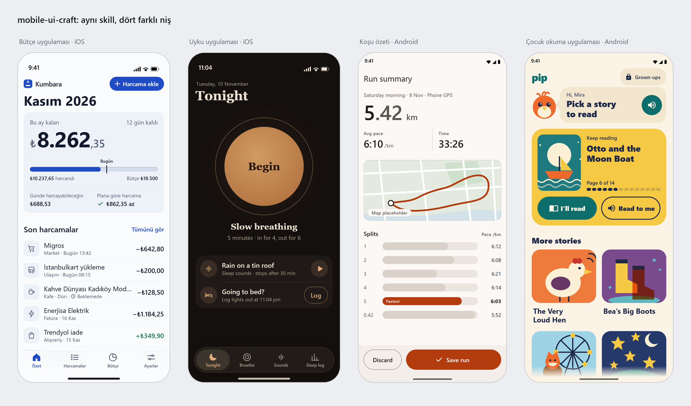
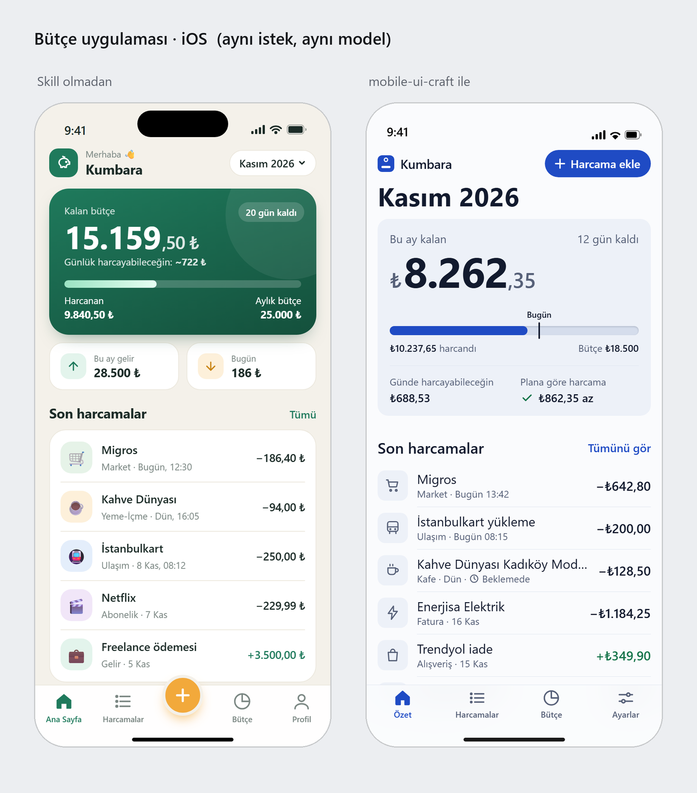
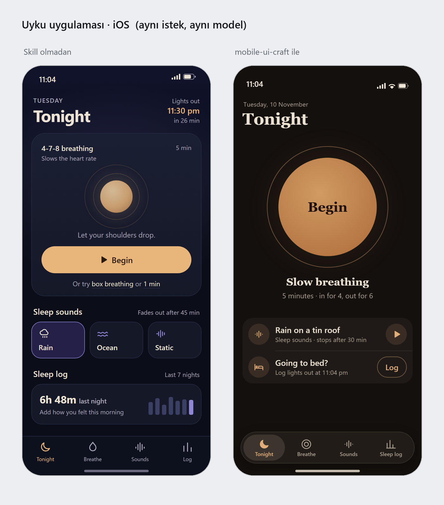
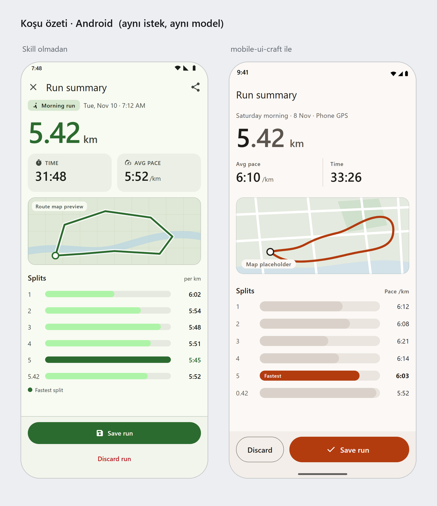
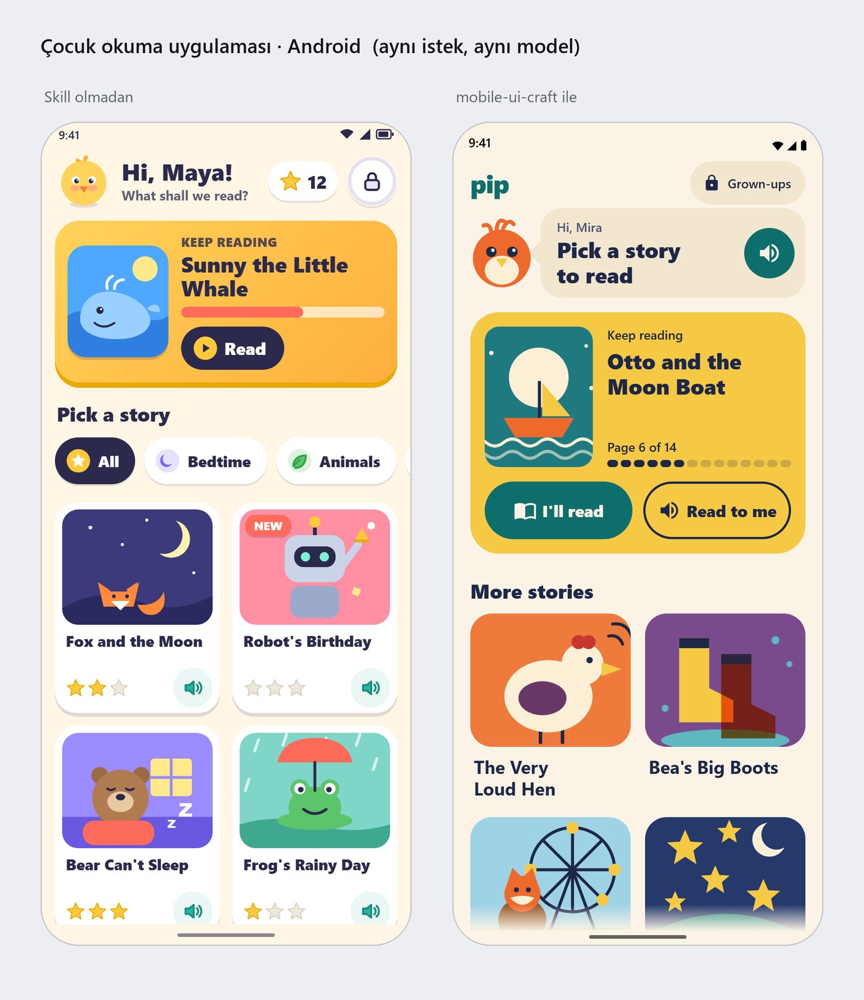

# skill4everything

Kişisel kullanım için AI ajan skill'leri. Açık standart olan `SKILL.md` biçiminde yazıldıkları için Claude Code, Codex, Cursor, Gemini CLI, GitHub Copilot, OpenCode, Amp, Zed ve bu biçimi okuyan diğer ajanlarda çalışır.

| Skill | Ne yapar |
|---|---|
| [`mobile-ui-craft`](skills/mobile-ui-craft/SKILL.md) | Mobil uygulama arayüzünü tasarlar, yazar, yeniden stillendirir ve inceler: platforma uygun, nişe oturan, AI yapımı gibi görünmeyen |

## mobile-ui-craft

iOS (SwiftUI, UIKit), Android (Jetpack Compose), Flutter ve React Native / Expo için. Üç şeyi hedefler:

1. **Platforma uysun.** Sistem gezinmesi, sistem kontrolleri, Dynamic Type, güvenli alanlar, geri hareketi.
2. **Ürüne otursun.** Banka uygulaması ile meditasyon uygulaması aynı görünmesin.
3. **Her görünür seçim karar verilmiş olsun.** AI yapımı arayüzün asıl sorunu yanlış olması değil, hiçbir şeyin seçilmemiş olması.



Yukarıdaki dört ekran aynı skill'in dört farklı nişe verdiği yanıt. Aşağıdakiler ise aynı istek ve aynı modelle (Claude Sonnet), solda skill olmadan, sağda skill ile üretildi. Hiçbiri elle düzeltilmedi.

| | |
|---|---|
|  |  |
|  |  |

Görseller native ekran değil, skill'in "kod yazmadan önce yönü gör" modunun ürettiği HTML mockup'lardır; fontlar, malzemeler ve kontroller yaklaşık çizimdir.

### Kurulum

Tüm ajanlar için tek komut ([skills CLI](https://github.com/vercel-labs/skills), Node 22+):

```bash
npx skills add kaantufan/skill4everything
```

Claude Code eklentisi olarak:

```
/plugin install mobile-ui-craft --marketplace kaantufan/skill4everything
```

Elle kurulum: `skills/mobile-ui-craft` klasörünü aşağıdaki yerlerden birine kopyala.

| Ajan | Proje klasörü | Kullanıcı klasörü |
|---|---|---|
| Claude Code | `.claude/skills/` | `~/.claude/skills/` |
| Codex, Cursor, Gemini CLI, Copilot, OpenCode, Amp, Zed | `.agents/skills/` | `~/.agents/skills/` |
| Windsurf | `.windsurf/skills/` | `~/.codeium/windsurf/skills/` |
| Kiro | `.kiro/skills/` | `~/.kiro/skills/` |
| Cline | `.cline/skills/` | `~/.cline/skills/` |
| claude.ai / Claude Desktop | `mobile-ui-craft` klasörünü zip'le, Ayarlar > Skills'ten yükle | |

Repo özel (private) olduğu sürece komutlar yalnızca bu repoya git erişimi olan makinelerde çalışır.

**Skill'in her oturumda devrede olması için:** ajanlar skill'leri yalnızca görev tetiklediğinde yükler ve ölçümlere göre bunu sık sık atlar. [`assets/always-on.md`](skills/mobile-ui-craft/assets/always-on.md) içindeki on satırı projenin `AGENTS.md`, `CLAUDE.md` ya da `GEMINI.md` dosyasına ekle. Skill desteği olmayan ajanlarda da aynı blok işe yarar.

### Nasıl şekil değiştirir

Skill her işte dört şeyi belirler ve yalnızca ilgili dosyaları okur:

| Karar | Seçenekler | Okunan dosya |
|---|---|---|
| Şerit | Tam yön, devralınmış tasarım sistemi, yerel cila | |
| Platform | iOS, Android, Flutter, React Native (+ iki platforma tek koddan) | `references/ios.md` vb. |
| Niş | 24 niş: fintech, kripto, fitness, meditasyon, verimlilik, notlar, sosyal, flört, e-ticaret, yemek, seyahat, eğitim, çocuk, medya, haber, AI asistan, araçlar, yaratıcı araçlar, akıllı ev, sağlık, emlak, oyun, B2B/saha, kamu | `references/niche-*.md` |
| Görev | Tasarım, yeniden stillendirme, inceleme, hareket, akışlar, önizleme | `craft`, `slop-tells`, `review`, `motion-haptics`, `ux-flows`, `preview` |

Her niş üç kadran için bir ön ayar verir; kadranlar soyut sıfatları ölçülebilir seçimlere çevirir:

- **D Yoğunluk** (1 ferah, 5 sıkı): satır yükseklikleri, bölüm aralıkları, kart mı ayraç mı.
- **E Enerji** (1 sakin, 5 ifadeli): renk doygunluğu, hareket, kutlama.
- **W Sıcaklık** (1 resmî ve keskin, 5 samimi ve yuvarlak): köşe yarıçapları, metin sesi, illüstrasyon.

Fintech `D4 E2 W2`, meditasyon `D1 E1 W4`, çocuk uygulaması `D1 E4 W5` ile başlar. Ajan kod yazmadan önce kısa bir brief doldurur (ürün, niş, kadranlar, yön, renklerin kaynağı, imza, kaçınılan klişe, reddedilen karanlık kalıplar), planı dört testle sınar, sonra kurar ve render alıp bakar.

Skill bilerek **palet, hex kodu ya da font listesi içermez**: "iyi seçenekler" menüsü bir sonraki varsayılana dönüşür. Renk ve biçim ürünün kendi dünyasından türetilir.

### İçindekiler

```
skills/mobile-ui-craft/
  SKILL.md              iş akışı, yönlendirme tabloları, 12 maddelik taban, niş dizini
  references/
    ios.md android.md flutter.md react-native.md cross-platform.md
    craft.md slop-tells.md motion-haptics.md ux-flows.md preview.md review.md
    niche-*.md          24 niş dosyası
  assets/
    always-on.md        AGENTS.md / CLAUDE.md için on satırlık kural bloğu
    phone-frame.html    HTML mockup için telefon çerçevesi (iOS ve Android)
  scripts/
    slop-scan.mjs       Swift, Kotlin, Dart, TSX ve HTML kaynağında AI işaretlerini sayan tarayıcı
  evals/                beş test senaryosu
tests/lint.mjs          skill yapısını doğrulayan lint
docs/previews/          bu sayfadaki görseller
RESEARCH.md             araştırma özeti ve eleştiri -> tasarım kararı tablosu
```

Tarayıcı tek başına da kullanılabilir (Node 18+, bağımlılık yok, ağ erişimi yok):

```bash
node skills/mobile-ui-craft/scripts/slop-scan.mjs lib/
```

### Test

```bash
node tests/lint.mjs
```

```bash
node skills/mobile-ui-craft/scripts/slop-scan.mjs --self-test
```

```bash
claude plugin validate .
```

**Karşılaştırmalı değerlendirme (2026-11-10).** Beş senaryo aynı istekle iki kez koşuldu: skill ile ve skill olmadan (Claude Sonnet, senaryo başına tek koşu). Çıktıları, önceden yazılmış 47 iddiaya göre ayrı bir puanlayıcı ajan değerlendirdi; nesnel iddialar (gradyan sayısı, emoji, web fontu, `flutter analyze`) script çıktısıyla kontrol edildi.

| Senaryo | Skill ile | Skill olmadan |
|---|---|---|
| Bütçe ana ekranı (iOS, Türkçe istek) | 10/10 | 5/10 |
| Uyku "Tonight" ekranı (iOS) | 10/10 | 6/10 |
| Koşu özeti (Android, Material 3) | 9/9 | 7/9 |
| Çocuk okuma ana ekranı (Android) | 9/9 | 4/9 |
| Flutter ekranını yeniden stillendirme | 8/9 | 5/9 |
| **Toplam** | **46/47 (%98)** | **27/47 (%57)** |

Bu sayılar okunurken:

- **Farkın bir kısmı rapor biçiminden geliyor.** İddiaların 8'i skill'in açıkça istediği iki rapor satırını ölçüyor (adlandırılmış yön, "doğrulanmadı" satırı). Onlar sayılmazsa sonuç 38/39'a karşı 27/39 (%97'ye karşı %69).
- **Taban model zaten yetkin.** Skill'siz çıktılar kötü değil. Skill'in kaldırdıkları: emoji ikonlar, selamlama başlığı, web fontu, dekoratif gradyanlar, sekme çubuğundaki eylem düğmesi. Eklediği: nişe uygun yoğunluk, tek yerden tema, raporda doğrulanmayanların yazılması.
- **Flutter senaryosunda tarayıcı sayımı:** girdi dosyasında 46 işaret vardı; skill ile 0'a, skill olmadan 24'e indi. İki çıktı da `flutter analyze`'dan hatasız geçti.
- **Maliyet:** skill'li koşular ortalama 1,4 kat token ve 2,8 kat süre harcadı (146 bine karşı 103 bin token, 249 saniyeye karşı 88 saniye).
- **Sonraki turlar.** İlk turdan sonra skill'e dört düzeltme yapıldı: Android çerçevesinin durum çubuğu, uydurma sayıların yeniden stillenmek yerine kaldırılması, yıkıcı eylemin birincil eylemden ayrı durması, aydınlık görünümün önce gelmesi (ilk turlarda dört ekrandan üçü koyu çıkmıştı). Etkilenen senaryolar yalnızca skill koluyla yeniden koşuldu. İkinci tur: koşu özeti 9/9, çocuk okuma 9/9, Flutter 7/9. Üçüncü tur: bütçe 10/10, çocuk okuma 9/9.
- **Flutter'daki 7/9 bir test hatasıydı.** İki iddianın metni skill'in platform kuralıyla çelişiyordu: iOS dalında 44 pt hedef ve Cupertino ikonu doğru davranıştır, iddialar ise "48" ve "tek ikon ailesi" diyordu. İddialar düzeltildi; o koşu yeniden puanlanmadı.
- **Görsellerdeki skill'li ekranlar** son turlardan: bütçe ve çocuk okuma üçüncü, koşu özeti ikinci, uyku birinci tur. Skill'siz ekranlar birinci turdan.
- **Sınırlar:** senaryo başına tek koşu, tek model; puanlayıcı hangi çıktının hangi kola ait olduğunu biliyordu. Sonuç bir kıyaslama değil, bir örnektir.

Senaryoları yeniden koşmak için (gerçek ve ücretli model koşularıdır):

```bash
cd skills/mobile-ui-craft && claude plugin eval . --allow-tools Write,Edit,Bash --scaffold
```

### Araştırma

Skill yazılmadan önce yaklaşık 90 skill reposu, platform kılavuzları, AI-slop üzerine yazılanlar ve gerçek uygulama eleştirileri tarandı. Her tekrarlayan eleştirinin skill'de neye dönüştüğü [RESEARCH.md](RESEARCH.md) içinde.

### Sınırlar

- Platform bilgisi 2026-11 itibarıyla kontrol edildi. Daha yeni bir SDK ile çelişirse SDK ve resmi belge geçerlidir.
- Önizlemeler HTML mockup'tır. Hareket, haptik ve gerçek his ancak cihazda değerlendirilebilir; skill bunu raporunda açıkça yazar.
- Araştırmada Reddit ve X doğrudan okunamadı (ayrıntı RESEARCH.md'de).
- Skill'in kendiliğinden tetiklenme oranı ölçülmedi.

## Lisans

MIT
