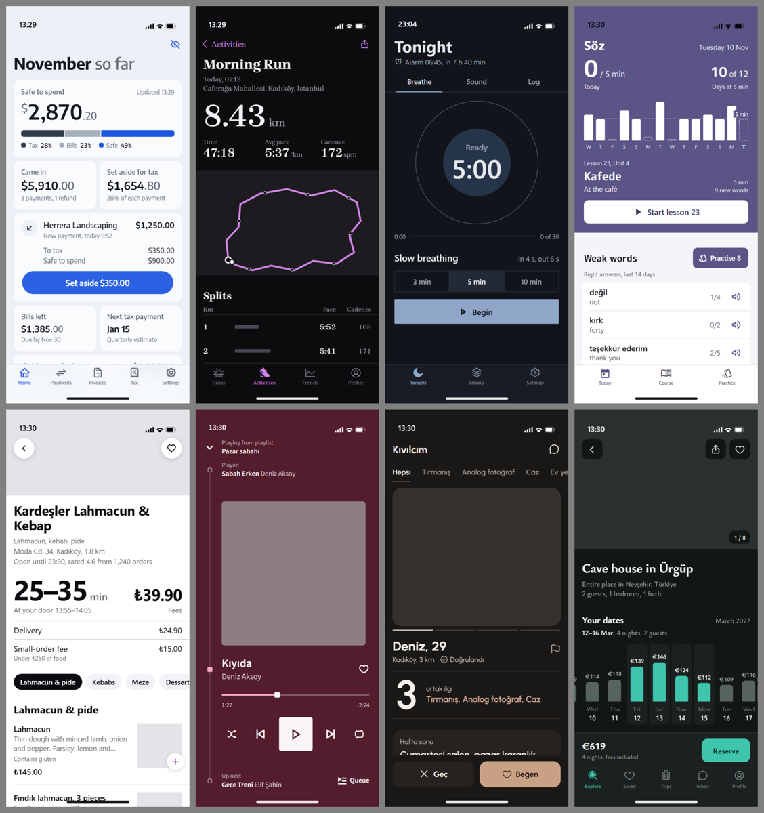

# skill4everything

Kişisel kullanım için AI ajan skill'leri. Açık standart olan `SKILL.md` biçiminde yazıldıkları için Claude Code, Codex, Cursor, Gemini CLI, GitHub Copilot, OpenCode, Amp, Zed ve bu biçimi okuyan diğer ajanlarda çalışır.

| Skill | Ne yapar |
|---|---|
| [`mobile-ui-craft`](skills/mobile-ui-craft/SKILL.md) | Mobil uygulama arayüzünü tasarlar, yazar, yeniden stillendirir ve inceler: her uygulamaya kendine ait, AI yapımı gibi görünmeyen bir görünüm verir |

## mobile-ui-craft

iOS (SwiftUI, UIKit), Android (Jetpack Compose), Flutter ve React Native / Expo için.

AI yapımı arayüzü ele veren tek şey "seçilmemiş" görünmesi değil; modelin kendi zevki de tanınıyor. Aynı birkaç font (Fraunces, Inter), vektörle elle çizilmiş resim ve ikonlar, renkli bir alan üstüne alttan yükselen yuvarlak köşeli bir kart, yumuşak parıltılar, orta noktayla dizilmiş künyeler, her şeyi anlatan cümleler. Bunlara bakmaya alışmış biri ekranı bir saniyede tanır.

Bu yüzden skill, zevkin göründüğü kararları modelden alır:

1. **Kartlar dağıtılır.** `scripts/deal.mjs` ürün adından tohumlanan bir el dağıtır: yazı tipi (90 aile; modellerin sık seçtiği 21 aile yasak), ikon seti (gerçek setler: Phosphor, Tabler, Remix, Material Symbols, Bootstrap), yerleşim iskeleti (15 tür), gezinme, köşe ailesi, zemin, palet yapısı, efekt bütçesi (yarısı tamamen düz), metin sesi, merkez öğe türü, renk tonu aralığı ve ilk görünüm. Aynı ürün hep aynı eli alır; iki ürün aynı eli almaz. El bağlayıcıdır, gerekçesi yazılmak şartıyla bir kez yeniden dağıtılabilir.
2. **Model malzeme üretmez.** İkon çizmez, resim çizmez. Fotoğraf, kapak ya da harita gereken yerde içinde yazı olmayan düz bir alan bırakır ve raporda ne konacağını söyler.
3. **Metin anlatmaz, etiketler.** Ekran başına en fazla bir açıklama cümlesi, kısa etiketler, sıradan örnek veri ("Morning Run", sıradan müşteri adları), ekranda yapım notu yok.
4. **Fikir hâlâ ürünün.** Ürünün kendi dünyasından tek bir fikir; artık resimle değil yapıyla, veriyle ve sözcüklerle görünür.
5. **Taban.** Dokunma hedefleri, metin ölçekleme, kontrast, durumlar, geri hareketi, karanlık kalıpların reddi.

### Ne üretiyor

Aşağıdaki sekiz ekranın her biri tek bir istekle, **Claude Opus 5.5 (high)** tarafından, skill (3.1) yüklüyken üretildi. Hiçbiri elle düzeltilmedi. Gri alanlar gerçek fotoğrafın, kapağın ya da haritanın geleceği yerler.



Aynı sekiz istek, aynı model, skill olmadan:


Prototipler [`docs/prototypes/v3/`](docs/prototypes/v3) klasöründe; tarayıcıda açıp dokunabilirsin. Bunlar native ekran değil, HTML prototiplerdir; fontlar ve kontroller native karşılıklarının yaklaşık halidir.

### Ölçüm: kör AI tespit testi

Soru "güzel mi" değil, "bunu AI mı yaptı, anlaşılıyor mu" idi. Sekiz nişte dört ekran karışık sırayla, AI arayüzlerini her gün gören bir uzman rolündeki iki bağımsız hakeme (Opus 5.5, high) gösterildi: skill 3.1, skill 3.0, skill'siz ve o nişin çok satan gerçek uygulaması. Hakemler kaçının AI olduğunu bilmiyordu; her ekrana "AI yaptı" olasılığı (0-100) ve gerekçe yazdılar. Ayrıca iki hakem her yapımcının sekiz ekranını tek sayfada görüp yapımcıyı değerlendirdi.

| | Ortalama AI olasılığı | "En AI" seçilme (16 karar) | Sekiz ekranlık sayfa (iki hakem) |
|---|---|---|---|
| Skill 3.1 | **80** | **0** | **82, 75** |
| Skill 3.0 | 85 | 3 | 88, 85 |
| Skill'siz | 88 | 13 | 85, 85 |
| Gerçek uygulama | 4 | 0 | |

Bu sonuçlar okunurken:

- **Skill'in kendi izi silindi.** Skill'siz çıktıların sekizde yedisi Inter, beşte dördü serif başlık, sekizde yedisi gradyan kullanıyor; hakemlerin tarifi "krem zemin, kiremit düğme, serif başlık: bugünün varsayılan AI görünümü". Skill 3 çıktılarında Fraunces, Inter, gradyan, elle çizilmiş ikon, orta nokta dizisi: sıfır.
- **Ama hâlâ yakalanıyor.** 80, "anlaşılmıyor" demek değil. Gerçek uygulama 4 alıyor; ama bunun büyük kısmı gerçek fotoğraf ve marka içeriğinden geliyor, karşılaştırma bu yüzden adil değil. Kalan işaretler: her ekranda dev bir sayının yanında küçük gri birim, bazı nişlerde ürüne özel grafik biçimleri, aynı brief'ten gelen aynı isimler. İlk ikisi ölçümden sonra kurala çevrildi; yeniden ölçülmedi.
- **Bir tur nasıl işledi.** 3.0'ı hakemler en çok ekrana sızmış yapım notlarından ("Map tiles here (MapKit in the build)"), veriyi anlatan cümlelerden ve özenli uydurma verilerden ("Moda'dan Fenerbahçe fenerine") yakaladı. 3.1 bunları kural yaptı, renk tonunu ve ilk görünümü de dağıtıma ekledi; ortalama 85'ten 80'e indi, "en AI" seçilmesi 3'ten 0'a.
- **Sınırlar.** Niş başına tek koşu, hakemler üreticiyle aynı model ailesinden, yalnızca durağan ilk kare değerlendirildi. Bir insan uzmanın gözü farklı şeyleri yakalayabilir.

### Sürüm 2 ölçümü: 8 niş, kör puanlama

Aşağıdaki ölçüm ve görseller 2.0 sürümüne aittir; 2.0 kimliği merkez öğe çizimiyle ve karakterli fontla kuruyordu. Kimlikte büyük kazanç sağladı ama AI tespit testinde en kolay yakalanan oydu (ortalama 92).


| Söz (dil) | Pano (finans) | Sofra (yemek) | Kumbara (bütçe) |
|---|---|---|---|
|  |  |  |  |

Sekiz niş için aynı istek iki kez koşuldu: skill ile ve skill olmadan, ikisi de Opus 5.5 (high). Her nişte iki bağımsız puanlayıcı (yine Opus 5.5, high) üç adayı beş ölçütte 1-10 arası puanladı: A ve B (hangisinin skill'li olduğunu bilmeden, sıraları iki puanlayıcıda ters) ve referans olarak o nişin çok satan gerçek bir uygulamasının App Store ekran görüntüleri.

| Niş | Referans | Skill ile | Skill'siz | Gerçek uygulama | İki puanlayıcının tercihi |
|---|---|---|---|---|---|
| Finans | Revolut | 7,5 | 6,8 | 7,2 | skill, skill |
| Koşu | Strava | 7,1 | 6,8 | 7,0 | skill'siz, skill |
| Uyku | Calm | 7,2 | 6,7 | 4,9 | skill, skill |
| Dil | Duolingo | 7,9 | 7,1 | 7,2 | skill, skill |
| Yemek | Uber Eats | 7,4 | 6,7 | 6,6 | skill, skill |
| Müzik | Spotify | 8,0 | 6,6 | 7,0 | skill, skill |
| Flört | Tinder | 7,2 | 6,0 | 6,2 | skill, skill |
| Seyahat | Airbnb | 7,9 | 7,1 | 7,5 | skill, skill |
| **Ortalama** | | **7,5** | **6,7** | **6,7** | **15 - 1** |

Ölçüt bazında ortalamalar:

| Ölçüt | Skill ile | Skill'siz | Gerçek uygulama |
|---|---|---|---|
| Kimlik (başka uygulamayla karıştırılamaz mı) | 8,4 | 4,9 | 6,8 |
| Etki (durup baktırıyor mu) | 7,9 | 5,3 | 5,8 |
| Cila | 7,0 | 7,3 | 7,3 |
| Netlik (kullanıcının işini görüyor mu) | 6,8 | 8,2 | 6,2 |
| Nişe uygunluk | 7,4 | 7,9 | 7,6 |

Bu sonuçlar okunurken:

- **Kazanç kimlik ve etkide.** Skill'siz tasarımlar derli toplu ama birbirine benziyor: sekizin altısı krem bir zemin üzerine kurulu ve çoğunda turuncu-kiremit bir vurgu var. Puanlayıcıların skill'siz taraf için en sık yazdığı kusur "jenerik, logoyu değiştir başka uygulama olur".
- **Bedeli netlik.** Skill'li tasarımlar netlikte 1,4 puan geride. Tekrarlayan eleştiriler: merkez öğe fazla yer kaplayıp istenen içeriği ekran dışına itiyor, yüzen düğmeler ve bildirimler içeriğin üstünü örtüyor, merkez öğedeki yazı yer yer soluk kalıyor.
- **Bu eleştiriler skill'e işlendi, ama yeniden ölçülmedi.** Ölçümden sonra eklenenler: merkez öğenin boyutu yoğunluk kadranına bağlandı, "istenen her şey ilk ekranda mı" testi, "hiçbir içerik yüzen öğenin altında kalmaz" kuralı, merkez öğe yazısına en güçlü kontrast.
- **Gerçek uygulama sütunu kaba bir çıtadır.** App Store görselleri pazarlama görselidir; çoğu aynı ekranı değil ana sayfayı gösteriyor, Calm'ınkilerde arayüz hiç yok (4,9 bu yüzden anlamsız). Prototiplerde gerçek fotoğraf da yok; puanlayıcılara bunu cezalandırmamaları söylendi.
- **Maliyet.** Skill'li koşular ortalama 1,5 kat token (164 bine karşı 112 bin) ve 2,7 kat süre (8,6 dakikaya karşı 3,2 dakika) harcadı.
- **Sınırlar.** Niş başına tek koşu. Puanlayıcılar üreticiyle aynı model ailesinden; hangi adayın skill'li olduğunu bilmeseler de kendi tarzına yatkınlık dışlanamaz. Sonuç bir kıyaslama değil, bir örnektir.

### Kurulum

Tüm ajanlar için tek komut ([skills CLI](https://github.com/vercel-labs/skills), Node 22+):

```bash
npx skills add kaantufan/skill4everything
```

Claude Code eklentisi olarak:

```
/plugin install mobile-ui-craft --marketplace kaantufan/skill4everything
```

Elle kurulum: `skills/mobile-ui-craft` klasörünü aşağıdaki yerlerden birine kopyala.

| Ajan | Proje klasörü | Kullanıcı klasörü |
|---|---|---|
| Claude Code | `.claude/skills/` | `~/.claude/skills/` |
| Codex, Cursor, Gemini CLI, Copilot, OpenCode, Amp, Zed | `.agents/skills/` | `~/.agents/skills/` |
| Windsurf | `.windsurf/skills/` | `~/.codeium/windsurf/skills/` |
| Kiro | `.kiro/skills/` | `~/.kiro/skills/` |
| Cline | `.cline/skills/` | `~/.cline/skills/` |
| claude.ai / Claude Desktop | `mobile-ui-craft` klasörünü zip'le, Ayarlar > Skills'ten yükle | |

Repo özel (private) olduğu sürece komutlar yalnızca bu repoya git erişimi olan makinelerde çalışır.

### Skill'in gerçekten yüklenmesi için

Skill'i kurmak yetmiyor. Gerçek dosyaları olan bir projede, 800'den fazla skill kurulu bir Claude Code'da ölçtüm (Opus 5.5, başsız oturumlar):

| Durum | Tetiklenmesi gereken isteklerde | Tetiklenmemesi gerekenlerde |
|---|---|---|
| Yalnızca skill kurulu | 5/30 | ölçülmedi |
| Skill açıklaması yeniden yazıldı | 4/20 | ölçülmedi |
| `CLAUDE.md`'de "her zaman açık" blok | 20/20 | 0/20 |

Neden: çok sayıda skill kuruluyken Claude Code bağlam bütçesi yüzünden yalnızca birkaç yerleşik skill'in açıklamasını gösteriyor; bu skill modele sadece adıyla görünüyor. Model önce koda bakıyor, sonra skill'i çağırmadan yazmaya başlıyor.

Çözüm: [`assets/always-on.md`](skills/mobile-ui-craft/assets/always-on.md) içindeki on satırı mobil projenin `CLAUDE.md`, `AGENTS.md` ya da `GEMINI.md` dosyasına ekle.

### Nasıl şekil değiştirir

Skill her işte dört şeyi belirler ve yalnızca ilgili dosyaları okur:

| Karar | Seçenekler | Okunan dosya |
|---|---|---|
| Şerit | Tam yön, devralınmış tasarım sistemi, yerel cila | |
| Platform | iOS, Android, Flutter, React Native (+ iki platforma tek koddan) | `references/ios.md` vb. |
| Niş | 24 niş: fintech, kripto, fitness, meditasyon, verimlilik, notlar, sosyal, flört, e-ticaret, yemek, seyahat, eğitim, çocuk, medya, haber, AI asistan, araçlar, yaratıcı araçlar, akıllı ev, sağlık, emlak, oyun, B2B/saha, kamu | `references/niche-*.md` |
| Görev | Tasarım, yeniden stillendirme, inceleme, hareket, akışlar, önizleme | `signature`, `craft`, `slop-tells`, `review`, `motion-haptics`, `ux-flows`, `preview` |

Dört kadran soyut sıfatları ölçülebilir seçimlere çevirir:

- **D Yoğunluk** (1 ferah, 5 sıkı): satır yükseklikleri, bölüm aralıkları, merkez öğenin kapladığı alan.
- **E Enerji** (1 sakin, 5 ifadeli): renk, hareket, kutlama.
- **W Sıcaklık** (1 resmî ve keskin, 5 samimi ve yuvarlak): köşeler, metin sesi, karakter.
- **X İfade** (1 sistem bileşenleri ve platform görünümü, 5 her şey ürüne özel): varsayılan 3. Saha, kurumsal, kamu ve klinik araçlarda ya da sade bir sonuç istendiğinde 1-2'ye iner.

Ajan kod yazmadan önce eli dağıtır ve kısa bir brief doldurur (ürün, niş, kadranlar, fikir, dağıtılan el, merkez öğe, renk tonunun kaynağı, hareket, kaçınılan klişe, reddedilen karanlık kalıplar), planı altı testle sınar, önce dağıtılan iskeleti kurar, sonra render alıp on soruluk parmak izi kontrolünü yapar.

Nişler davranışı belirler (kullanıcının o andaki hali, güven sinyalleri, tasarlanacak durumlar, reddedilecek kalıplar); yüzeyin ne kadar cesur olacağını İfade kadranı belirler.

### İçindekiler

```
skills/mobile-ui-craft/
  SKILL.md              iş akışı, yönlendirme tabloları, dört kadran, 13 maddelik taban, niş dizini
  references/
    signature.md        eli dağıtma, merkez öğe, yazı, renk, ikon, metin, parmak izi kontrolü
    ios.md android.md flutter.md react-native.md cross-platform.md
    craft.md slop-tells.md motion-haptics.md ux-flows.md preview.md review.md
    niche-*.md          24 niş dosyası
  assets/
    always-on.md        CLAUDE.md / AGENTS.md için on satırlık kural bloğu
    phone-frame.html    HTML prototip için telefon çerçevesi (iOS ve Android)
  scripts/
    deal.mjs            ürün adından yazı tipi, ikon seti, iskelet, renk aralığı ve efekt bütçesini dağıtır
    capture.mjs         prototipi gerçek telefon boyutunda, gerçek zamanlı, birkaç anda yakalar
    slop-scan.mjs       Swift, Kotlin, Dart, TSX ve HTML kaynağında seçilmemiş varsayılanları sayar
  evals/                dokuz test senaryosu
tests/lint.mjs          skill yapısını doğrulayan lint
docs/previews/          bu sayfadaki görseller
docs/prototypes/        açıp dokunabileceğin prototipler
RESEARCH.md             araştırma özeti ve eleştiri -> tasarım kararı tablosu
```

Script'ler bağımlılıksızdır (Node 18+) ve tek başına kullanılabilir:

```bash
node skills/mobile-ui-craft/scripts/deal.mjs --seed "Pano" --platform ios
```

```bash
node skills/mobile-ui-craft/scripts/capture.mjs docs/prototypes/v3/language.html shots/soz --at 1200,3000,6500
```

```bash
node skills/mobile-ui-craft/scripts/slop-scan.mjs lib/
```

### Test

```bash
node tests/lint.mjs
```

```bash
node skills/mobile-ui-craft/scripts/slop-scan.mjs --self-test
```

```bash
node skills/mobile-ui-craft/scripts/deal.mjs --self-test
```

```bash
claude plugin validate .
```

Senaryoları yeniden koşmak için (gerçek ve ücretli model koşularıdır):

```bash
cd skills/mobile-ui-craft && claude plugin eval . --allow-tools Write,Edit,Bash --scaffold
```

### Sürüm geçmişi

- **1.0** platforma uygunluk ve AI işaretlerinin temizlenmesi üzerine kuruluydu. Sonnet ile yapılan iddia tabanlı testte skill'li koşular 46/47, skill'siz koşular 27/47 aldı; ama çıktılar "daha temiz" olmaktan öteye geçmiyordu.
- **2.0** bu geri bildirim üzerine yeniden yazıldı: fikir ve merkez öğe zorunlu, İfade kadranı eklendi, hareketli prototip ve gerçek zamanlı yakalama geldi. Yukarıdaki "Sürüm 2 ölçümü" bu sürüme aittir.
- **3.0** "hâlâ AI-slop duruyor" geri bildirimi üzerine: yazı tipi, ikon, iskelet ve efekt artık modelin değil dağıtım script'inin seçimi; model resim ve ikon çizmiyor. **3.1** ilk AI tespit testinin bulduklarını ekledi: ekranda yapım notu yok, metin anlatmıyor, sıradan örnek veri, dağıtılan renk aralığı ve ilk görünüm, yakalamada açık mod sabit.

### Araştırma

Skill yazılmadan önce yaklaşık 90 skill reposu, platform kılavuzları, AI-slop üzerine yazılanlar ve gerçek uygulama eleştirileri tarandı. Ayrıntılar [RESEARCH.md](RESEARCH.md) içinde.

### Sınırlar

- Prototipler HTML'dir. Hiçbir ekran simülatörde ya da cihazda denenmedi; SwiftUI, Compose ve React Native için kod üretimi test edilmedi (Flutter için bir senaryo `flutter analyze`'dan geçti, o da 1.0 ile).
- İddialı bir prototipi native koda çevirmek, sistem bileşenleriyle kurmaktan daha fazla iştir; özel gezinme ve kontrollerde erişilebilirlik elle sağlanmalıdır.
- Platform bilgisi 2026-11 itibarıyla kontrol edildi. Daha yeni bir SDK ile çelişirse SDK ve resmi belge geçerlidir.
- Araştırmada Reddit ve X doğrudan okunamadı.

## Lisans

MIT
